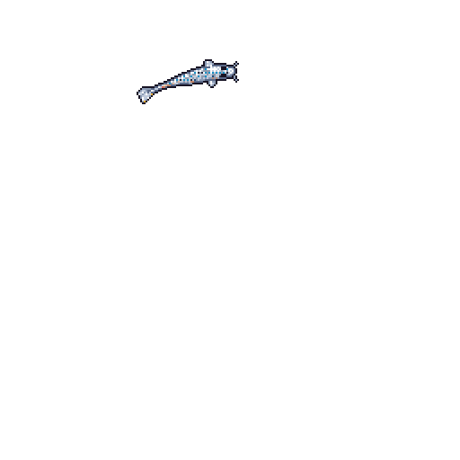

# Hey, I'm Dhruv

You’ve somehow ended up here. Congrats.

This is my little corner on GitHub where I throw random projects, experiments, and half-baked ideas into the void. Some of it works. Some of it doesn’t. Either way, it’s all here.

## What’s in here?
- Code that may or may not break spectacularly
- Weird projects I got curious about
- Stuff I thought was cool at 3 AM
- Notes, scripts, and whatever else I felt like uploading

## Wanna stalk me a bit more?
[www.thingalaya.com](https://thingalaya.com)

## Final thoughts
If you find something useful, awesome. If not, feel free to shake your head and move along. Or clone it and see what happens. Either way, welcome.

